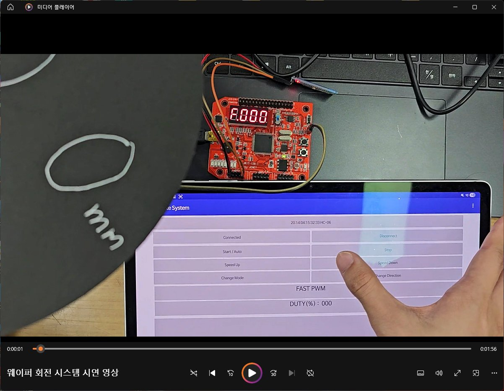
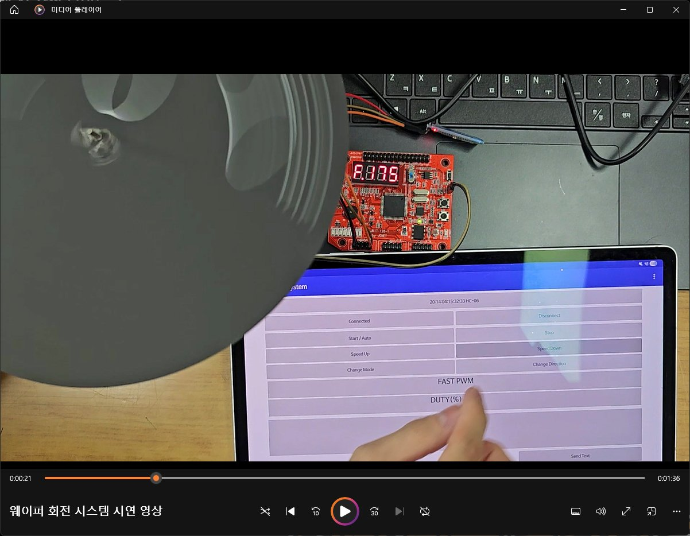
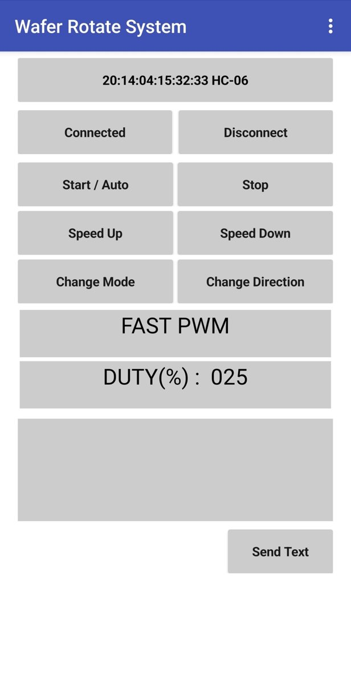
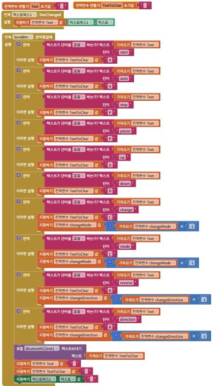
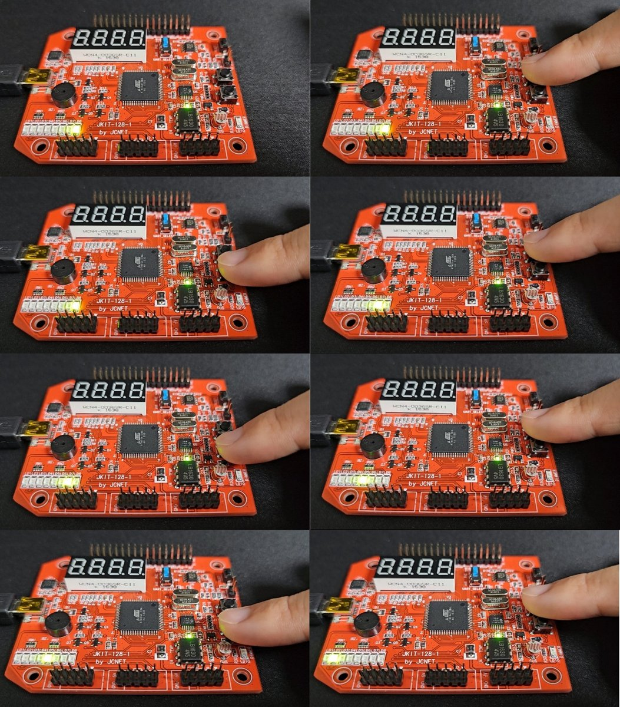
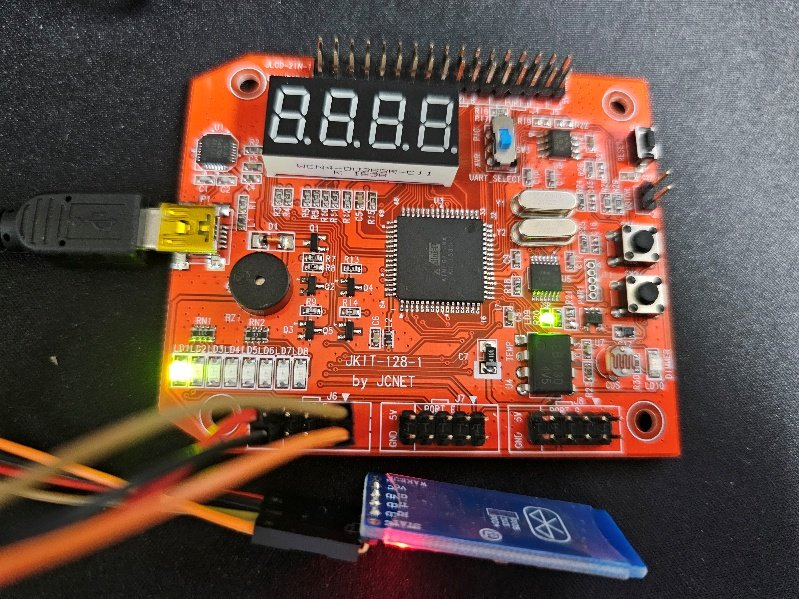
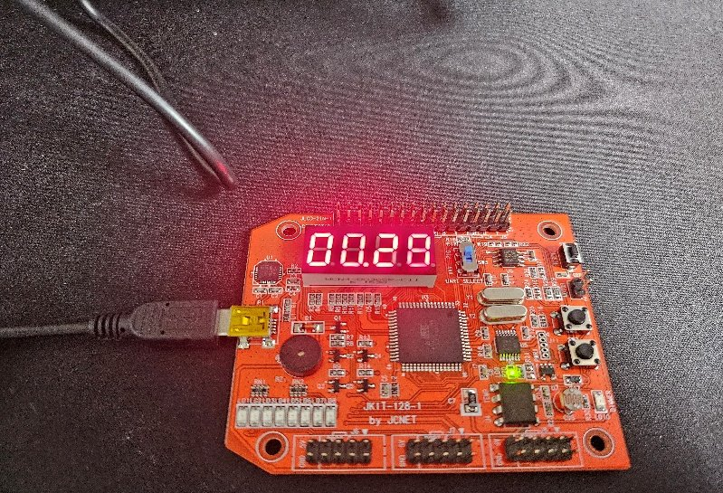

# ATmega128 Microprocessor Projects

> **GPIO·인터럽트·UART·ADC·Timer/PWM 실습과 Wafer Rotate System 구현**

ATmega128 마이크로컨트롤러를 이용한 마이크로프로세서 실험 과목의 C 코드 모음이다. GPIO와 스위치 제어에서 시작해 센서 데이터 취득, UART·Bluetooth 통신, 타이머 인터럽트와 PWM 제어까지 실습한 뒤, 이를 **Wafer Rotate System**에 통합했다.

문서(HWPX)에 정리되어 있던 소스 코드를 독립적인 `.c` 파일로 추출했다. 최종 팀 프로젝트에서는 **ATmega128 펌웨어의 PWM 모터 제어, UART 명령 처리, 외부 인터럽트와 FND 표시 코드**를 담당했다. 스마트폰 App Inventor 앱은 팀원이 제작했으며, 아래 앱 화면과 블록 이미지는 팀 프로젝트의 연동 구조를 보여주기 위해 포함했다.

---

## Project Showcase — Wafer Rotate System

<p align="center">
  
</p>

반도체 공정에서 사용되는 회전 제어의 기본 원리를 실습하기 위해 ATmega128, DC 모터, Bluetooth 모듈(HC-06), 4자리 FND를 연결한 소형 회전 제어 시스템을 구현했다. 스마트폰에서 명령을 전송하면 MCU가 모터 상태를 변경하고 듀티값을 UART로 회신한다. 보드의 외부 스위치로도 속도를 조절할 수 있다.

### 주요 구현 기능

| 기능 | 구현 방식 |
|---|---|
| 모터 속도 제어 | Timer/Counter2의 `OCR2`를 이용한 PWM 듀티값(0–255) 제어 |
| PWM 모드 변경 | Fast PWM / Phase Correct PWM 전환 (`TCCR2`) |
| 원격 제어 | HC-06 Bluetooth와 UART0 수신 인터럽트 (`USART0_RX_vect`) |
| 물리 버튼 | `INT4`, `INT5` 인터럽트로 속도 증감 |
| 상태 표시 | PORTC/PORTG를 이용한 4자리 FND 다중화 출력: `F/P` 및 듀티값 |
| 상태 회신 | 현재 듀티값을 3자리 ASCII 문자열로 UART 전송 |

### 제어 흐름

```text
App Inventor 앱 (팀원 제작)
        │ Bluetooth / HC-06
        ▼
   ATmega128 UART0
        │ 수신 인터럽트
        ▼
   명령 해석 (A/P/U/D/R/C)
        ├── Timer2 PWM → DC motor
        ├── PORTC/PORTG → 4-digit FND
        └── UART TX → 앱으로 듀티값 회신

   PE4 / PE5 버튼 → INT4 / INT5 → 속도 증감
```

### UART 명령

| 수신 문자 | 기능 |
|---|---|
| `A` | 정방향, Fast PWM, 듀티 125로 시작 |
| `P` | 모터 정지 |
| `U` | 듀티 25 증가 |
| `D` | 듀티 25 감소 |
| `C` | Fast / Phase Correct PWM 모드 전환 |
| `R` | 방향 상태 전환 |

통신 속도는 16 MHz 설정 기준 `9600 bps`로 구성했다. FND에는 PWM 모드(`F` 또는 `P`)와 듀티값 세 자리를 표시한다.

<p align="center">
  
</p>

### 스마트폰 연동

<p align="center">
  
  
</p>

앱에서는 시작·정지, 듀티 증감, PWM 모드 및 방향 변경 명령을 보낼 수 있다. 앱 UI 및 블록은 **팀원 제작물**로, 이 저장소에는 연동된 ATmega128 펌웨어를 중심으로 코드를 공개했다.

원본 발표자료에 기록된 [프로젝트 시연 영상](https://youtu.be/niigrT1GZXg)도 참고할 수 있다.

### 구현 과정에서 확인한 사항

- **FND 모드 문자 출력:** 초기 버전에서 `F/P` 표시가 의도대로 나오지 않아 4자리 다중화 표시 로직을 수정했다.
- **역방향 속도 제어의 제약:** 최종 코드의 역방향 전환에서는 Timer2 PWM 출력을 중단한다. 따라서 정방향과 동일한 PWM 속도 조절이 역방향에도 적용되는 구조는 아니다. 당시 사용한 보드·모터 결선의 제약으로 기록되어 있다.

**최종 펌웨어:** [`04_Wafer_Rotate_System/main.c`](04_Wafer_Rotate_System/main.c)  
**초기 구현 코드:** [`04_Wafer_Rotate_System/early_prototype.c`](04_Wafer_Rotate_System/early_prototype.c)

---

## Other Coursework Labs

### 1. GPIO & External Interrupt

GPIO 레지스터(`DDRx`, `PORTx`, `PINx`)를 이용해 LED를 제어하고, 스위치 입력을 폴링 방식과 외부 인터럽트 방식으로 각각 구현했다. 기본 실습 6개와 패턴 이동·방향·지연시간을 바꾸는 심화 코드 6개를 개별 파일로 분리했다.

<p align="center">
  
</p>

- **Basic:** LED 좌·우 이동, NOP 지연, PE4 폴링, INT4/INT5 외부 인터럽트
- **Extended:** 가변 이동량, 방향 전환, 지연 조절, 8비트 LED 패턴 증감
- **코드:** [`01_GPIO_Interrupt/`](01_GPIO_Interrupt/)

### 2. UART, ADC & Bluetooth

UART0 송수신, 광센서의 ADC 변환, Bluetooth를 통한 LED 제어, 4자리 FND 출력 및 스마트폰 제어 스톱워치를 구현했다. 실습 중 ADC 값을 UART로 보낼 때 숫자를 ASCII 문자로 변환해야 하는 문제와, Bluetooth 모듈의 보드레이트를 일치시켜야 하는 문제를 확인하고 수정했다.

<p align="center">
  
  
</p>

- UART 문자열 전송 및 구구단 프로그램
- ADC 조도센서 값 송신, 임계값 기반 LED On/Off
- HC-06 UART 수신 인터럽트와 LED 원격 제어
- 4자리 FND 스톱워치 및 ADC 값 표시
- **코드:** [`02_UART_ADC_Bluetooth/`](02_UART_ADC_Bluetooth/)

### 3. Timer/Counter

Timer0의 오버플로, 비교일치 및 CTC 모드를 이용해 LED 패턴을 주기적으로 이동하는 세 가지 실습 코드를 정리했다.

- Timer0 Overflow ISR
- Timer0 Compare Match ISR
- Timer0 CTC Mode
- **코드:** [`03_Timer_Counter/`](03_Timer_Counter/)

---

## Repository Structure

```text
ATmega128_Microprocessor_Projects/
├── 01_GPIO_Interrupt/
│   ├── basic/                 # GPIO와 외부 인터럽트 실습 6개
│   └── extended/              # LED 제어 심화 실습 6개
├── 02_UART_ADC_Bluetooth/     # UART, ADC, Bluetooth, FND 실습 8개
├── 03_Timer_Counter/          # Timer0 기반 실습 3개
├── 04_Wafer_Rotate_System/
│   ├── main.c                 # 최종 팀 프로젝트 펌웨어
│   └── early_prototype.c      # 초기 스핀코터 구동 코드
├── assets/                    # README용 실습·시연 사진
├── Makefile
└── README.md
```

총 **25개의 독립 C 소스 파일**이 있다. 각 파일에 별도의 `main()`이 있으므로 프로젝트 전체를 한 번에 컴파일하지 않고, 실습 예제 하나씩 빌드한다.

## Build & Run

### 개발 환경

- **Target MCU:** ATmega128
- **Board:** 수업에서 사용한 ATmega128 실습 보드(JKIT-128-1)
- **Clock:** 16 MHz (`F_CPU=16000000UL`)
- **Language:** C (AVR register-level programming)
- **Toolchain:** AVR-GCC + avr-libc (또는 해당 MCU를 지원하는 AVR 개발 환경)
- **Peripherals:** DC motor, HC-06, 4-digit FND, switches, light sensor

프로젝트 루트에 포함된 `Makefile`로 개별 소스 파일의 HEX를 빌드할 수 있다. 컴파일에는 `avr-gcc`, `avr-objcopy`, `avr-libc`가 필요하다.

```bash
# 최종 Wafer Rotate System 펌웨어
make

# 다른 실습 소스를 선택해서 빌드
make SOURCE=03_Timer_Counter/03_timer0_ctc.c TARGET=timer0_ctc

# 출력 삭제
make clean
```

출력은 `build/` 폴더 아래 `.elf`, `.hex`로 생성된다. 펌웨어 업로드는 사용 중인 실습 보드와 프로그래머 환경에 맞게 별도로 수행해야 한다. 실습 예제는 사용하는 포트와 주변장치 결선에 따라 동작 조건이 달라진다.

### Notes

- 원본 HWPX의 C 코드 부분을 소스 파일로 분리하고 들여쓰기를 정리했다. 기존 제어 알고리즘과 레지스터 설정은 임의로 재설계하지 않았다.
- 실습 심화 코드는 과제 당시 기록된 구현을 보존한 것으로, 모든 코드의 보드별 동작을 새로 검증한 것은 아니다.
- 실제 AVR 툴체인 및 보드가 없는 환경에서 원문 추출 파일들의 **C 구문 검사는 완료**했으나, ATmega128 타깃 컴파일·플래싱 및 실물 구동 재시험은 별도로 필요하다.
- 앱 인벤터 앱의 프로젝트 원본(`.aia`)과 수업 보고서·강의자료는 이 저장소에 포함하지 않았다.

---

**Kwangwoon University · Microprocessor Laboratory · ATmega128**
